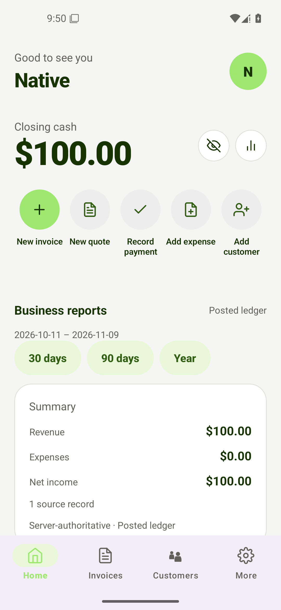

# Installed Android acceptance — 2026-11-09

The emulator run matched `jeevanvj/main` at
`04059068fafe73d6c88f75bc9e6479cf0cfedd66`. `origin/main` is the older remote.
Before the pull request, main advanced to `492b58ff4b258f9d7685aee36cefba8a34ce3e6f`
(#175, agent router). That commit does not change these mobile screens. This
report covers the local fixes, not a deployed release.

## Build and environment

The final release APK is `mobile/android/app/build/outputs/apk/release/app-release.apk`.
Its SHA-256 is recorded in [build.json](build.json). It is a **debug-signed x86_64
local-test APK**, installed on Android 15/API 35 (`LedgerCraftNativeQA`,
`emulator-5560`). The emulator runs headless; interaction and screenshots use ADB.
It uses a synthetic, isolated SQLite database at
`.tmp/feature-verification/android-2026-11-09/ledger.sqlite`, with the Node API on
port 3109. No production data, recipients, deployment, OTA or store publication.

After dependency installation, run Expo Android prebuild. For this local-only
binary, the generated, ignored Android manifest enables cleartext loopback HTTP
and disables Expo Updates so the embedded bundle is authoritative. These changes
are not release configuration. Run Gradle **from `mobile/android`**, with Node
20.20, Java 21, and the installed Android SDK:

```sh
EXPO_PUBLIC_API_URL=http://127.0.0.1:3109 \
EXPO_PUBLIC_APP_ORIGIN=easybizinvoice:// \
SENTRY_DISABLE_AUTO_UPLOAD=true \
./gradlew :app:assembleRelease -PreactNativeArchitectures=x86_64 --max-workers=2 \
  '-Dorg.gradle.jvmargs=-Xmx4g -XX:MaxMetaspaceSize=2g -Dfile.encoding=UTF-8'
adb -s emulator-5560 reverse tcp:3109 tcp:3109
adb -s emulator-5560 install -r app/build/outputs/apk/release/app-release.apk
```

The first build hit a Gradle metaspace limit; the command above succeeded with
release lint enabled. Final build: [android-build.log](android-build.log).
The local API runs with Node 24.13; the host Node 26/Corepack combination failed.

## Reproduced issues and fixes

1. **Failed login/signup lost the form.** Global auth loading unmounted navigation.
   Submissions now keep the form mounted and use its existing submission state.
   [Before](signup-failure-loses-form.png), [failed login retained](12-login-failure-retains-form.png),
   [offline signup retained](13-signup-error-retains-form.png).
2. **Android invoice keyboard collapsed the usable form.** Removed the duplicate
   keyboard-height adjustment where Android already resizes the window.
   [Before](keyboard-before.png), [amount editable with keyboard](06-keyboard-amount-accessible.png).
3. **Home presets excluded the current Auckland business date.** Presets now use
   the server organisation-calendar day; the actual report date range is visible.
   Saved ranges remain unchanged. A failed date lookup preserves the current report
   and displays an error. [Before](10-dashboard-before.png),
   [correct period](14-dashboard-correct-period.png), [network error](15-dashboard-network-error.png).

Regression tests failed before each fix and passed after it. The final rebuilt
APK contains all three fixes. Auth and keyboard checks were performed on the
preceding fixed APK; the final rebuild additionally verified dashboard dates,
network failure, session continuity and the persisted invoice state.

## Native UI journey and persisted results

| Scenario | Outcome / evidence |
| --- | --- |
| Signup and business onboarding | Synthetic NZ business; [Home](01-onboarding-home.png) |
| Guided invoice validation and customer creation | [Validation](02-invoice-validation.png), [draft saved](03-draft-saved.png) |
| Invoice preview and native PDF sharing | [Preview](04-invoice-preview.png), [Android share sheet](05-native-pdf-share.png); dismissed without sending |
| Keyboard editing | Second NZ$25 draft saved using the amount field with keyboard open |
| Issue NZ$100 invoice | One invoice journal; draft had no posting before issue |
| Overpayment | NZ$101 rejected against NZ$100 balance; [screenshot](07-overpayment-rejected.png) |
| Partial payment / repeat tap | NZ$40 recorded once; [NZ$60 remaining](08-remaining-sixty.png), [read-back](partial-payment-readback.json) |
| Offline remaining payment / retry | No false success; pending attempt retained, restored connection settled NZ$60 once; [offline state](09-payment-connection-error.png) |
| Force-stop / relaunch | Paid state and session persisted; [screenshot](11-paid-after-relaunch.png) |
| Business calendar report | October 11–November 9, cash/revenue/net income NZ$100 each |

[Final SQLite read-back](persistence-readback.json) confirms exactly two payments
(NZ$40 + NZ$60), zero balance on invoice 0001, draft invoice 0002 at NZ$25,
and exactly three posted journals. Independent Python Decimal sums verify each
journal's debit equals credit. Draft 0002 remains unposted. Invoice payment
capture created **zero receipt records**; invoice PDF sharing is separate and
this run does not claim receipt generation or receipt sharing acceptance.



## Automated verification

- [Mobile Jest](mobile-jest.log): **150 suites / 684 tests passed**. Jest reports
  a worker teardown warning; this is not a clean open-handle audit.
- [Mobile lint](mobile-lint.log): **0 errors, 74 warnings**.
- [Mobile strict TypeScript](mobile-tsc.log): passed (empty successful output).
- [Focused invoice/payment API tests](native-api-tests.log): **15 files / 65 tests passed**.
- [iOS production JS export](native-ios-export.log): passed; not an iOS binary/device test.
- Native journey used direct ADB UI actions and screenshots, followed by SQLite
  read-back. Initial Maestro attempts did not complete; no automated Maestro
  end-to-end pass is claimed.

## Remaining boundaries

This is installed-emulator acceptance for the flows above, not all 25 domain
procedures. Physical Android, installed iOS, camera/receipt scanning, other
accounting domains, and real email/Stripe/AI providers remain unverified in this
run. The local API reports those providers unavailable. No hosted CI was run.
