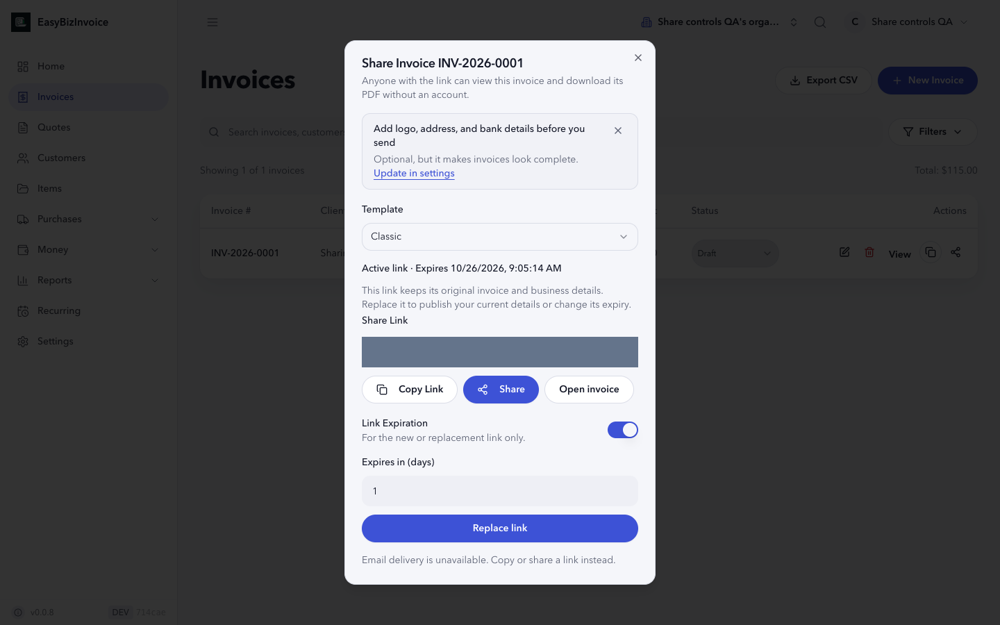
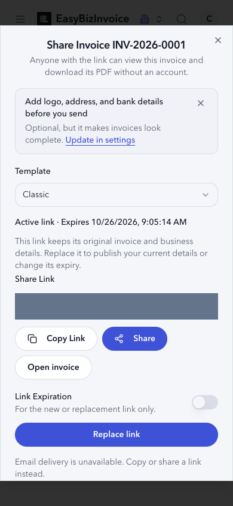
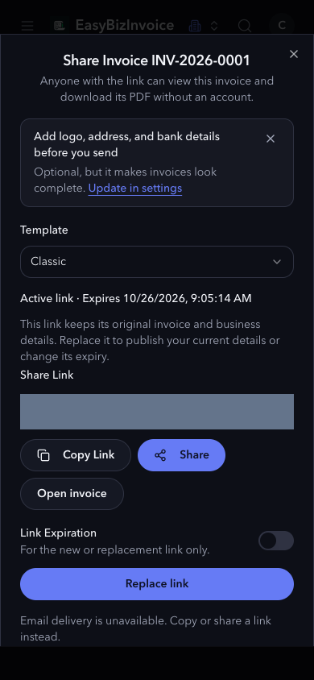
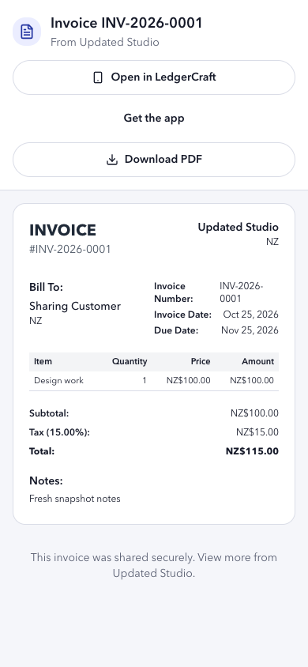
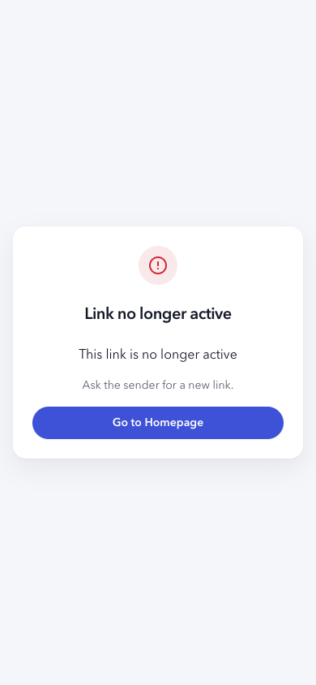
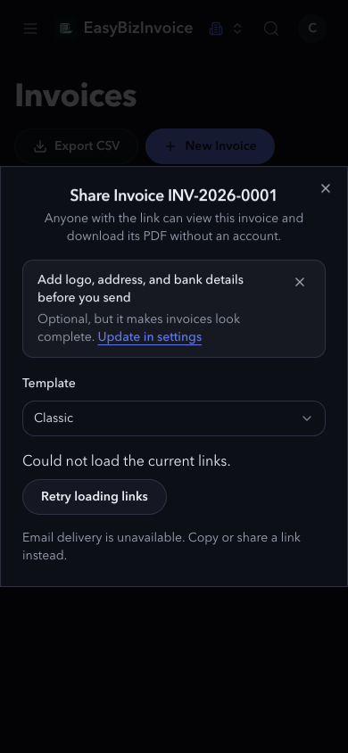

# Invoice sharing controls — local verification, 2026-10-25

Scope: mobile share-link management and the web expiry integration from the
[approved #37 plan](https://github.com/jeevan-vj/ledger-craft-app/issues/37#issuecomment-6382647824).
The API's intentional immutable snapshot reuse is unchanged. No release was published.

## Test-first evidence

- Web expiry repro on original code: `ShareInvoiceModal > displays the actual permanent expiry when the API reuses a link despite a one-day request` failed with `expected document not to contain element` and `Expires in 1 day` (exit 1). After the change, actual `No expiry` is displayed and changing an existing expiry requires confirmed replacement.
- Mobile controls: six new behavior tests failed on the original sheet (missing server-backed status/actions), then passed after implementation.
- Independent review found a delayed list response could restore a revoked token in both query caches. Deferred-response regressions failed before query cancellation/settlement fixes and passed afterward.
- Mobile lost-response regression failed before reconciliation: a revoke committed by the server could leave the old link shown as active. Tests now cover authoritative refresh, failed refresh disabling actions, and status retry without blindly replacing twice.
- Supporting SQLite integration assertions verify reuse preserves the old invoice/profile snapshot, replacement publishes current details and actual expiry, old tokens return 410, rollback preserves old links, and exact totals remain unchanged.

## Browser and recipient proof

`tests/e2e/invoice-sharing-controls-local.spec.ts` passed against this worktree's
Vite on port 8082, local Hono on 3001, and a disposable SQLite database. Port 8080
was occupied by unrelated work and was left untouched. The repository Playwright
workflow was used with a temporary config selecting the installed Chrome channel
and local base URL. The committed test also works with the normal local 8080 config:

```sh
pnpm exec playwright test tests/e2e/invoice-sharing-controls-local.spec.ts --project=chromium
```

All business reads/writes used real Hono persistence. Only the deliberate list
network failure was intercepted, to verify the error state and successful retry.
The recipient used a separate signed-out browser context (`/api/me` returned 401).
The interactive T3 browser additionally verified local signup, `/api/me` 200,
link generation, explicit one-day replacement, and the responsive modal.

Verified flow:

1. No link → generate permanent link → reopen and reuse original link/snapshot.
2. Change invoice notes and business name; the old snapshot remains unchanged.
3. Request one-day expiry; current link still displays its actual no-expiry status.
4. Cancel replacement; old link remains. Confirm replacement; old link becomes 410.
5. New recipient sees updated invoice/profile, unchanged `115.00` total, and the actual one-day server expiry.
6. Download `Invoice-INV-2026-0001.pdf`: `%PDF-` signature and over 1 KB; recipient preview contains the expected customer, line, notes, and total.
7. Revoke through Hono; new recipient link becomes inactive. Fail sender list loading, retry, and generate a new permanent link.

Screenshots mask the disposable share token. Resizing between desktop and phone
reopens the modal through the respective invoice-list layout. Light and dark
phone states were visually inspected, including the action buttons and overflow.

| Desktop 1440×900 | Phone 390×844 | Dark phone |
| --- | --- | --- |
|  |  |  |

| Signed-out recipient | Revoked recipient | Retry state |
| --- | --- | --- |
|  |  |  |

## Native verification boundary

Node 20 Jest verifies native share-sheet dismissal semantics with mocks, plus
PDF cancellation, copy/share existing link, replace/revoke confirmations, expiry,
errors, retries, query races, and token privacy. iOS/Android exports verify bundling.
These are **not authenticated native-device proof**.

Installed iOS runtimes were found, but the booted simulators belong to unrelated
VOLT work. No installed LedgerCraft build, matching local `.app`, or native UI
automation driver was found; Expo Go cannot substitute for the custom
`react-native-bottom-tabs` module. Those simulators were left untouched. Android
inventory did not establish a usable device. Authenticated native share-sheet
cancellation, recipient deep links, and production Android `assetlinks.json`
signing verification remain separate follow-up work. Email/reminders remain
unavailable. No signing configuration, release, or dependency changes were made.
